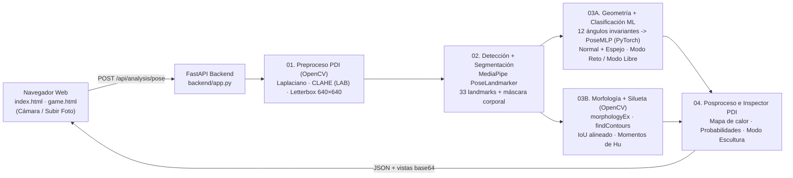

# MIMESIS — Sistema Interactivo de Análisis e Imitación de Esculturas

> **Procesamiento Digital de Imágenes (PDI · 2026-2)** · Universidad Autónoma de Occidente (UAO)  
> **Docente:** Nicolás Llanos Neuta · **Temática:** *Análisis de la Expresión Humana en el Arte y la Cultura*  
> **Autores:** Alejandro Quintero, Julián Cruz y Sebastián Montaño

---

## 1. Descripción del Proyecto

### Problemática y justificación
La observación de obras escultóricas en museos y espacios educativos suele ser pasiva y rara vez dirige la atención hacia la geometría expresiva del cuerpo humano (inclinación del torso, apertura de brazos, flexión de piernas y orientación de la cabeza). Aunque imitar la postura de una escultura promueve el aprendizaje activo, sin retroalimentación objetiva resulta difícil evaluar qué tan fiel fue la imitación o qué zona corporal corregir.

### Objetivos
- **Objetivo general:** Diseñar, implementar y evaluar un sistema interactivo web que integre procesamiento digital de imágenes (PDI), visión computacional y aprendizaje automático para analizar la imitación corporal de esculturas.
- **Objetivos específicos:**
  1. Aplicar un pipeline medible de preprocesamiento PDI en OpenCV (control de nitidez, mejora adaptativa de contraste y redimensionamiento sin deformación).
  2. Integrar estimación de pose (MediaPipe BlazePose) y segmentación de silueta con morfología matemática (`OpenCV`).
  3. Entrenar y desplegar un clasificador propio (`PoseMLP` en PyTorch) sobre características angulares invariantes para calificar e identificar poses en dos modos de juego (**Modo Reto** y **Modo Libre · Adivina la Obra**).
  4. Validar el sistema con pruebas automatizadas y métricas cuantitativas sobre datos reales capturados por el equipo.

### Solución propuesta
**MIMESIS** es una aplicación web local por turnos (2 a 4 participantes) respaldada por un servidor Python (`FastAPI`). Captura una fotografía puntual (sin grabar video continuo), ejecuta el pipeline PDI + BlazePose + Segmentación + `PoseMLP` y entrega:
- Puntaje de similitud (`0–100`), mapa de calor por región (**Cabeza, Torso, Brazos, Piernas**) y esqueleto superpuesto (alternable entre segmentos anatómicos y mapa de calor).
- Clasificación automática entre las 3 obras de la colección (**Sebastián de Belalcázar**, **El Discóbolo** y **William Shakespeare**).
- Similitud diagnóstica de silueta (**IoU alineado** y **Momentos de Hu**) + vista **Modo Escultura**.
- **Inspector Visual del Pipeline PDI** para auditar en vivo cada transformación de OpenCV.

---

## 2. Arquitectura del Sistema



---

## 3. Metodología

1. **Preprocesamiento PDI (`backend/pdi.py`):**
   - **Control de nitidez:** varianza del operador Laplaciano (`cv2.Laplacian`, umbral `40.0`) para alertar desenfoque por movimiento.
   - **Mejora adaptativa de iluminación:** conversión `BGR → LAB` y aplicación de **CLAHE** (`clipLimit=2.0, tileGridSize=(8,8)`) únicamente sobre el canal `L` cuando la luminancia media `< 115` o el contraste `< 42`.
   - **Letterboxing sin deformación:** escalado preservando relación de aspecto en lienzo `640×640` + proyección inversa (`unletterbox_point` y `unletterbox_mask`) para no alterar ángulos corporales.
2. **Detección de Pose y Extracción de Características (`backend/pose.py`):**
   - Estimación de 33 landmarks con MediaPipe BlazePose (`PoseLandmarker`).
   - Cálculo de **12 ángulos corporales invariantes** a traslación, escala, fondo y vestimenta (usando 15 puntos clave), con manejo de oreja oculta en vistas de perfil (`_compute_head_tilt`: fallback `oreja visible → nariz`).
3. **Segmentación y Análisis de Forma (`backend/segmentation.py`):**
   - Extracción de máscara de segmentación corporal refinada mediante **apertura y cierre morfológico** (`cv2.morphologyEx`), conservación del componente conexo principal y extracción del contorno externo (`cv2.findContours`).
   - Cálculo diagnóstico de **IoU de silueta normalizada** (preservando relación de aspecto y soportando espejo horizontal) y similitud de forma mediante **Momentos de Hu** (`cv2.matchShapes`).
4. **Clasificación y Calificación (`backend/evaluator.py`):**
   - Evaluación invariante a espejo horizontal (`_mirror_angles`).
   - Similitud por región (`head 12%`, `torso 25%`, `arms 38%`, `legs 25%`) + clasificador propio **`PoseMLP`** (`12 → 64 → 32 → 3` con `BatchNorm1d` y `Dropout`), combinando `60% PoseMLP + 40% precisión geométrica`.
   - **Modo Libre ("Adivina la Obra"):** clasifica la postura entre las 3 esculturas sin conocer la clase objetivo, incluyendo detección de postura no reconocida cuando la confianza y similitud son `< 45%`.

---

## 4. Implementación y Guía de Ejecución

### Estructura del repositorio
```text
Mimesis/
├── index.html                          # Sala: 2–4 jugadores, Modo Reto / Modo Libre, colección
├── game.html                           # Partida: cámara, evaluación, mapa de calor, Inspector PDI, ranking
├── css/                                # Estilos editoriales de museo oscuro cálido
├── js/                                 # sculptures.js, lobby.js, game.js
├── assets/sculptures/                  # Fotografías reales de las 3 esculturas
├── backend/
│   ├── app.py                          # Servidor FastAPI (/api/health, /api/analysis/pose + estáticos)
│   ├── pdi.py                          # Laplaciano, CLAHE LAB, letterboxing y vistas Inspector PDI
│   ├── pose.py                         # MediaPipe PoseLandmarker + 12 ángulos invariantes
│   ├── segmentation.py                 # Morfología OpenCV, findContours, IoU y Momentos de Hu
│   ├── evaluator.py                    # PoseMLP (PyTorch), Modo Reto, Modo Libre y espejo
│   ├── extract_references.py           # Extractor offline de poses y máscaras de las 3 esculturas
│   ├── data/                           # reference_poses.json, reference_masks/, reference_previews/
│   ├── models/                         # pose_landmarker_full.task y pose_mlp.pt (entrenado en Colab)
│   └── tests/test_pipeline.py          # Pruebas automatizadas del pipeline completo
└── notebooks/
    └── Mimesis_MLP_Entrenamiento.ipynb # Notebook Colab: ablación PDI, comparativa ML y export .pt
```

### Instalación y ejecución local
Requiere **Python 3.10–3.13**. Desde la raíz del proyecto:

```powershell
# 1. Instalar dependencias
pip install -r backend/requirements.txt

# 2. (Opcional) Regenerar poses y máscaras de referencia de las 3 esculturas
python -m backend.extract_references

# 3. Ejecutar pruebas automatizadas
python -m unittest backend.tests.test_pipeline -v

# 4. Iniciar servidor local (API + interfaz web)
python -m uvicorn backend.app:app --reload
```

Abrir en el navegador: **`http://localhost:8000`**

---

## 5. Datos

- **Referencias escultóricas (3 obras):** fotografías reales de *Sebastián de Belalcázar*, *El Discóbolo* y *William Shakespeare* en `assets/sculptures/`. Sus 33 landmarks, 12 ángulos y máscaras binarias limpias se almacenan en `backend/data/reference_poses.json` y `backend/data/reference_masks/`.
- **Dataset propio del equipo (329 fotografías reales depuradas, sin fuga entre conjuntos):**
  - **`train`:** `258` imágenes (`86` Belalcázar · `86` Discóbolo · `86` Shakespeare; `514` muestras tras aumento en espejo horizontal aplicado únicamente sobre `train`).
  - **`val`:** `23` imágenes (`9` Belalcázar · `5` Discóbolo · `9` Shakespeare).
  - **`test`:** `48` imágenes perfectamente balanceadas (`16` Belalcázar · `16` Discóbolo · `16` Shakespeare).
  - *Enlace al dataset en Google Drive:* `(insertar enlace público de lectura aquí antes de la entrega final)`

---

## 6. Interfaz Gráfica de Usuario (GUI)

- **Sala (`index.html`):** selección de 2–4 jugadores con edición directa de nombres, selector de modo (**Modo Reto** vs. **Modo Libre · Adivina la Obra**), ficha museográfica y verificación en vivo del motor Python (`PoseMLP activo`).
- **Partida (`game.html`):**
  - Captura con cámara web (PC o celular por USB) con rotación `0°/90°/180°/270°`, espejo y cuenta regresiva de 3 s, o carga directa de foto de prueba.
  - **Tres vistas interactivas sobre tu resultado:** `Segmentos (15 pts)`, `Mapa de calor (Verde/Ámbar/Rojo)` y `Vista Escultura (Segmentación)`.
  - **Barras de probabilidad del clasificador ML** + **Mapa de calor por región** + **Diagnóstico PDI & Silueta (IoU / Momentos de Hu)**.
  - **Modal "Inspector Pipeline PDI":** exhibe en tiempo real `Original → CLAHE LAB → Mapa Laplaciano → Máscara + Contorno → Modo Escultura`.
  - **Ranking por ronda y acumulado** con rotación automática entre esculturas.

---

## 7. Resultados y Validación

### Experimento de ablación PDI (329 imágenes reales del equipo)
- **Sin preprocesamiento PDI:** detección BlazePose `327 / 329` (`99.4%`), visibilidad media `0.942`.
- **Con PDI (CLAHE adaptativo en LAB + Letterboxing 640×640):** detección BlazePose **`328 / 329` (`99.7%`)**, visibilidad media **`0.942`** (`100%` de detección en `val` `23/23` y `100%` en `test` `48/48`).

### Comparativa cuantitativa de modelos (`Train: 258 [86×3] · Val: 23 [9/5/9] · Test: 48 [16×3]`)

| Modelo / Enfoque | Entrada | Val Accuracy (Macro-F1) | Test Accuracy (Macro-F1) | Observaciones |
| :--- | :--- | :---: | :---: | :--- |
| CNN RGB (Parcial 2 *baseline*) | Píxeles RGB | 83.3% (—) | 77.1% (—) | Sensible a fondo, ropa e iluminación |
| Random Forest | 12 ángulos + PDI | 91.3% (0.883) | 95.8% (0.959) | Invariante a fondo y escala |
| SVM (RBF) | 12 ángulos + PDI | 91.3% (0.883) | 97.9% (0.979) | Mejor puntaje en test (`47/48`) |
| **PoseMLP (PyTorch · producción)** | **12 ángulos + PDI** | **91.3% (0.883)** | **95.8% (0.959)** | **+8.0 pp en val y +18.7 pp en test vs. CNN RGB (`46/48`); 17.7 KB, tiempo real** |

- **Desglose `PoseMLP` en `Test` (`n = 48`, 16 por clase):** Belalcázar `16/16` (`F1 = 0.94`), Discóbolo `15/16` (`F1 = 0.97`), Shakespeare `15/16` (`F1 = 0.97`) — únicamente 2 errores en todo el conjunto de prueba balanceado.

### Pruebas automatizadas (`backend/tests/test_pipeline.py`)
- **7/7 pruebas aprobadas (`OK` en 1.44 s)** validando: Laplaciano y CLAHE adaptativo, letterboxing + `unletterbox_point`/`unletterbox_mask`, refinamiento morfológico + IoU/Hu en espejo, generación de vistas del Inspector PDI, `_compute_head_tilt` (frontal vs. perfil), invarianza en espejo del evaluador y flujo extremo a extremo en `Modo Reto` y `Modo Libre` con `PoseMLP` activo.
- Prueba E2E sobre fotografía real (`Fotos Prueba/Discobolo/20261015_132054.jpg`) con `PoseMLP` cargado: identificación correcta como **`discobolo` (`100.0%` de confianza)** en Modo Libre, `score = 86.1` en Modo Reto, `IoU = 44.9%`, `Hu = 40.6%` y generación completa de las 5 vistas del Inspector PDI.

---

## 8. Conclusiones

- **Logros:** MIMESIS integra en un único sistema funcional PDI clásico (OpenCV), detección de pose (BlazePose), segmentación con morfología matemática e indicadores de forma (IoU/Hu) y clasificación con aprendizaje automático propio (`PoseMLP`, `95.8%` en test y `91.3%` en val, superando en `+18.7 pp` a la CNN RGB del Parcial 2), haciéndolo auditable en tiempo real mediante el Inspector Pipeline PDI y el Modo Libre.
- **Limitaciones:** La precisión disminuye si el jugador queda recortado de cuerpo (sin piernas visibles) o en contraluces extremos; además, el IoU de silueta es más sensible a vestimenta holgada que los 12 ángulos articulares (por lo que se reporta como métrica diagnóstica).
- **Trabajo futuro:** Ampliar la colección de esculturas, incorporar análisis de expresión facial (`FaceLandmarker` blendshapes) para evaluar la emoción asociada a cada obra y desplegar el servicio en un servidor en la nube con soporte móvil nativo.
