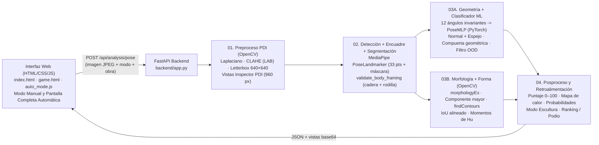
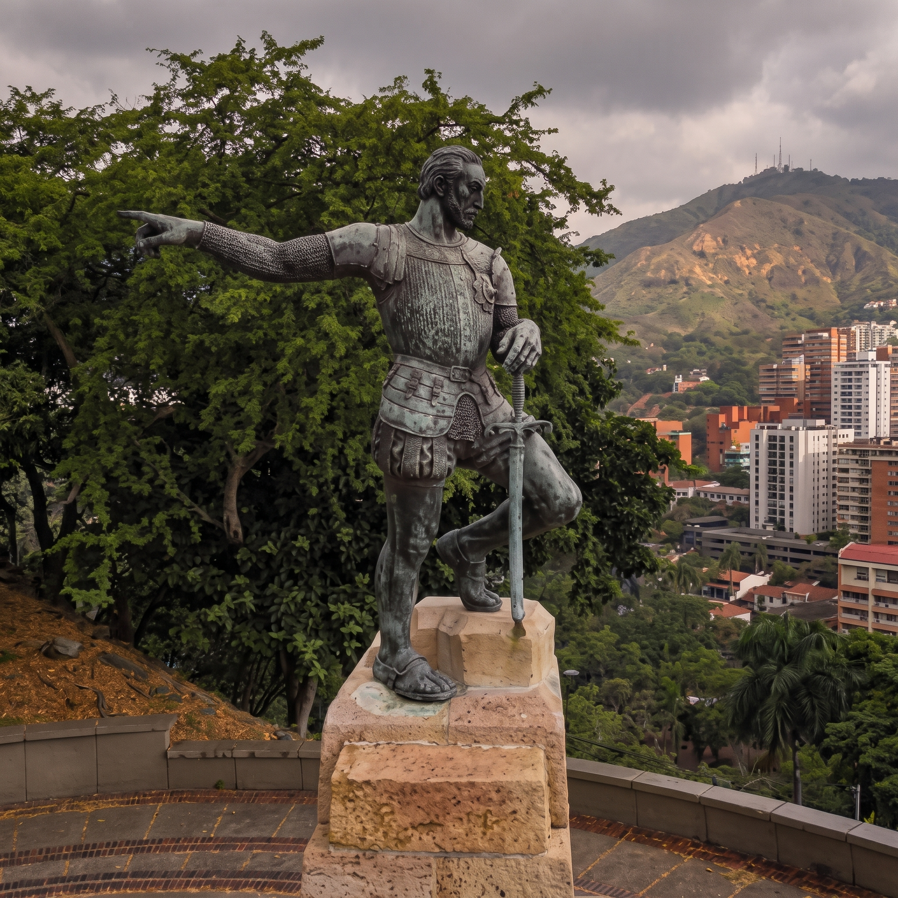
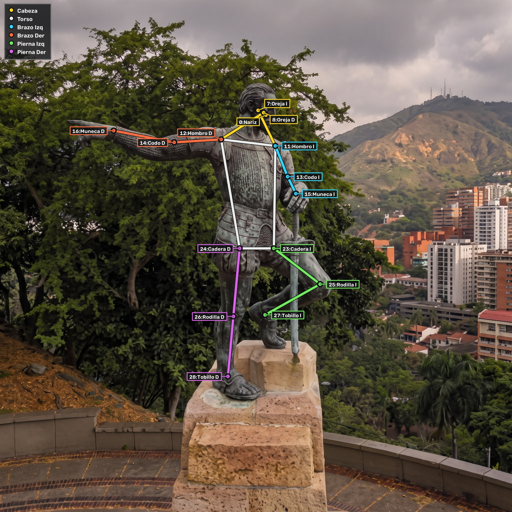
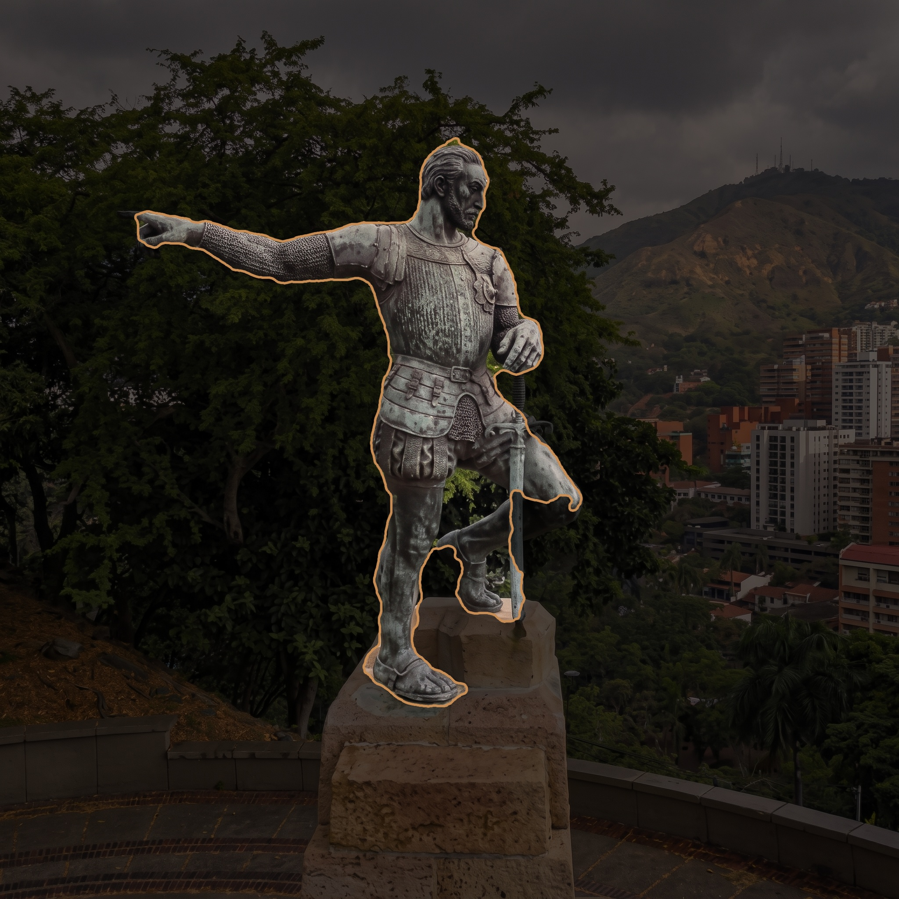
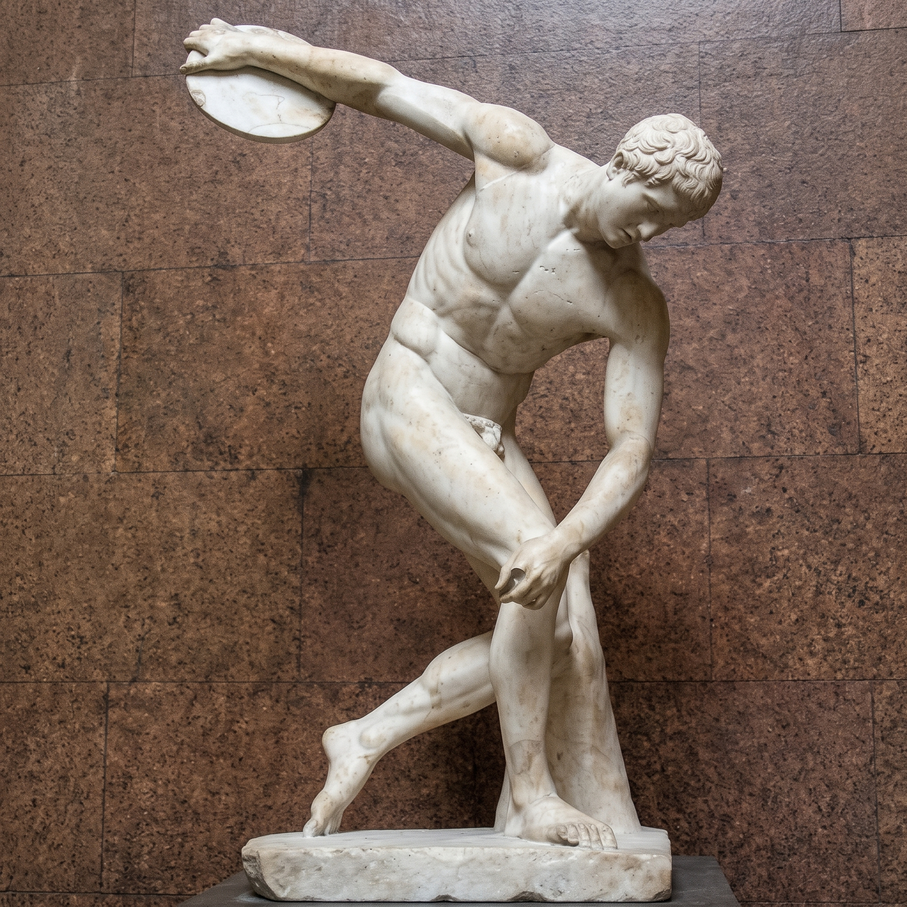
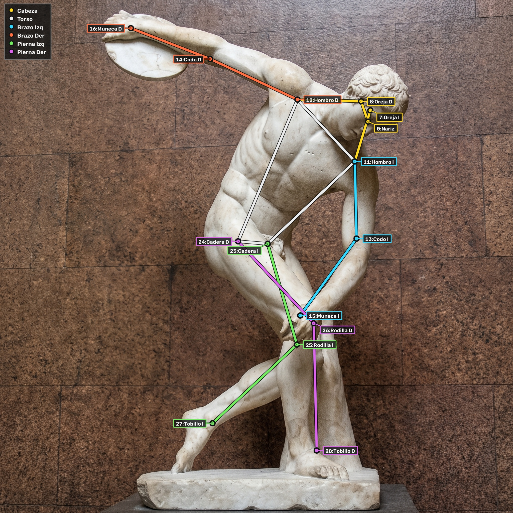
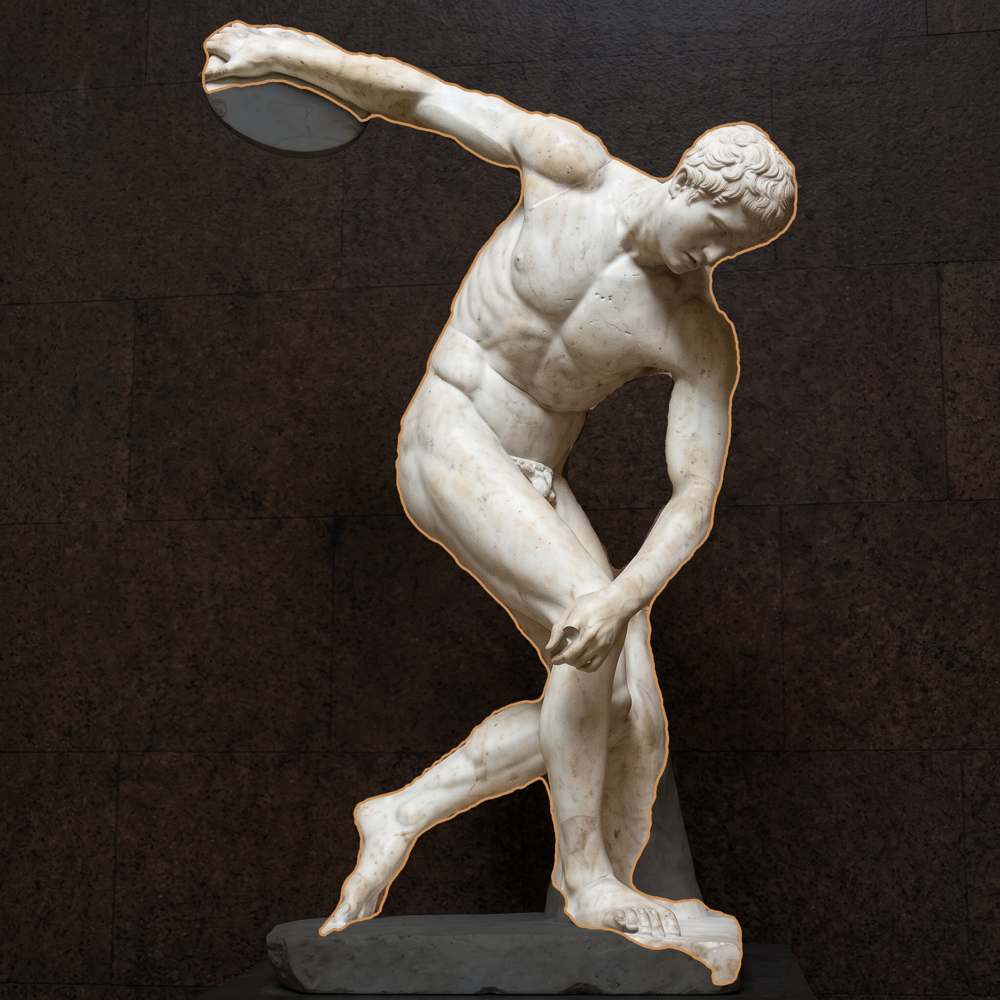
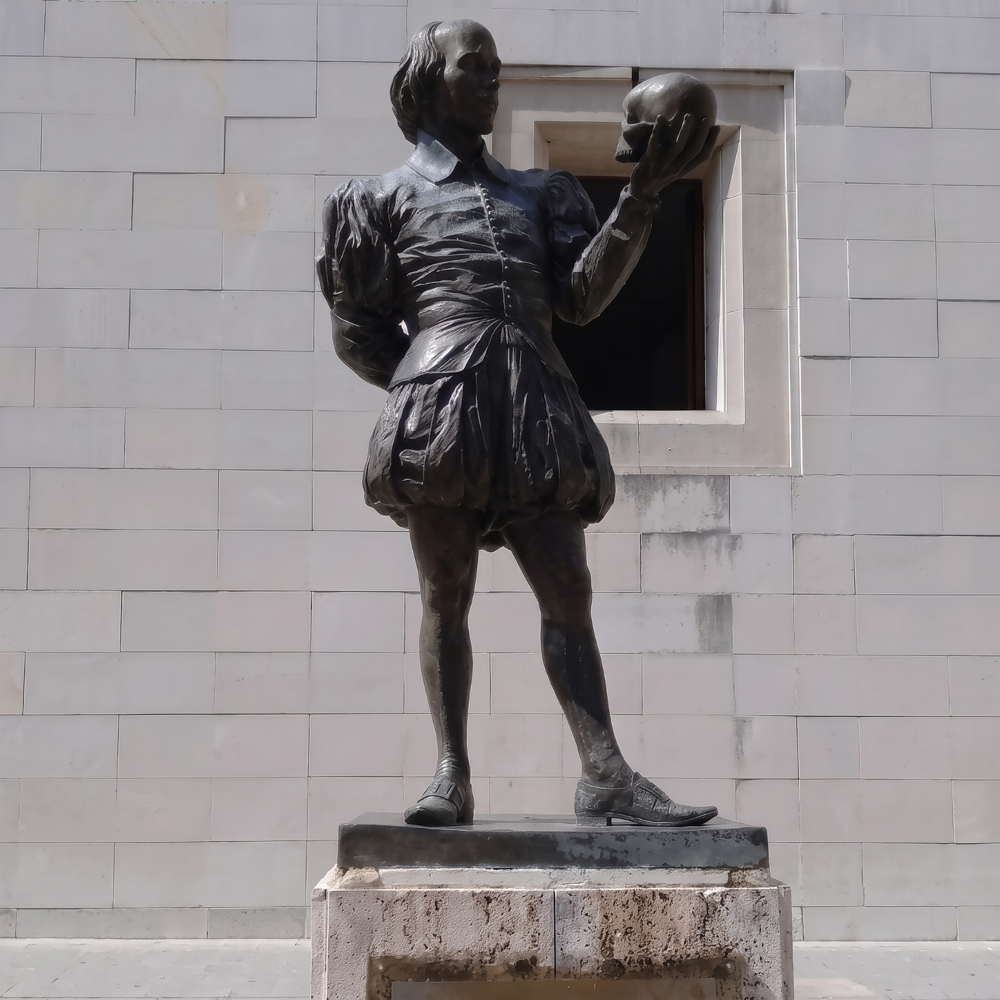
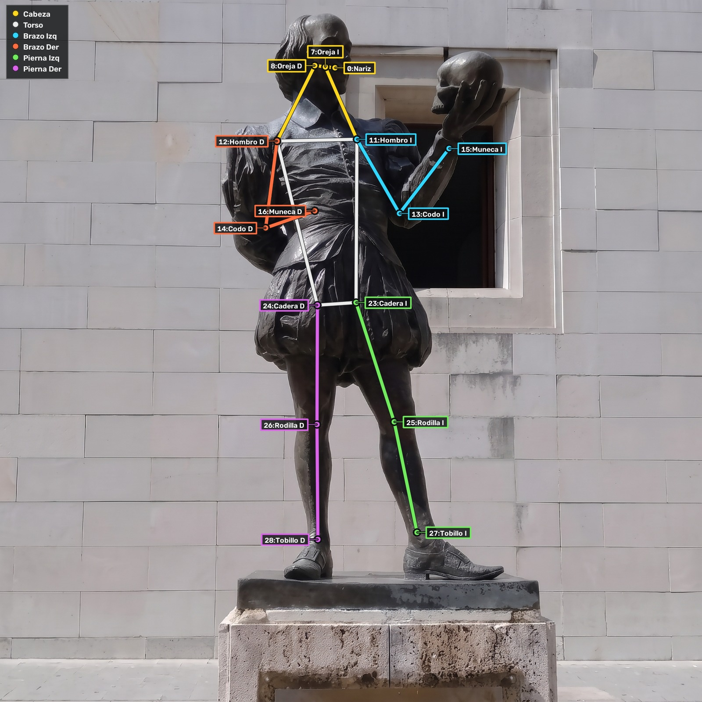
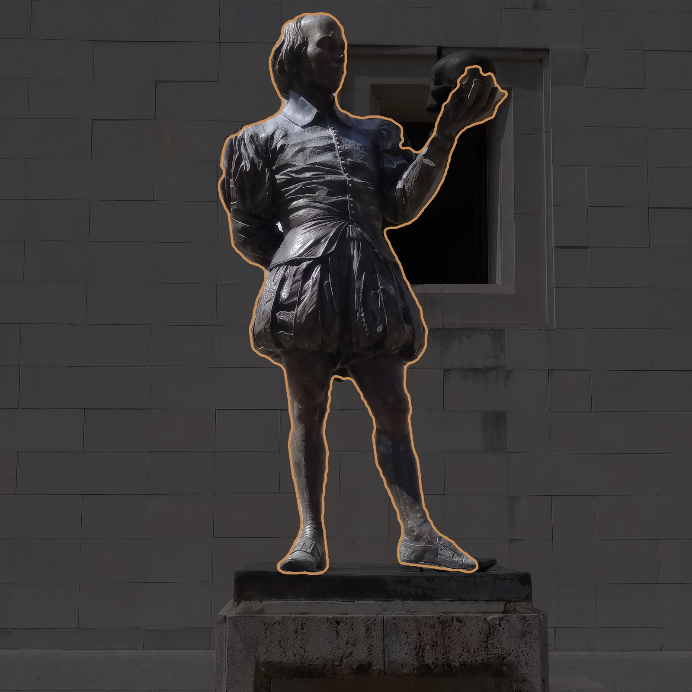

# MIMESIS — Sistema Interactivo de Análisis e Imitación de Esculturas

> **Procesamiento Digital de Imágenes (PDI · 2026-2)** · Universidad Autónoma de Occidente (UAO)  
> **Docente:** Nicolás Llanos Neuta · **Temática:** *Análisis de la Expresión Humana en el Arte y la Cultura*  
> **Autores:** Alejandro Quintero, Julián Ruiz y Sebastián Montaño

---

## 1. Descripción del Proyecto

### Problemática y justificación
La observación de obras escultóricas en museos y espacios educativos suele ser pasiva y rara vez dirige la atención hacia la geometría expresiva del cuerpo humano (inclinación del torso, apertura de brazos, flexión de piernas y orientación de la cabeza). Aunque imitar la postura de una escultura promueve el aprendizaje activo y participativo, sin retroalimentación objetiva resulta difícil evaluar qué tan fiel fue la imitación o qué región corporal corregir.

### Objetivos
- **Objetivo general:** Diseñar, implementar y evaluar un sistema interactivo web basado en técnicas de procesamiento digital de imágenes, visión computacional y aprendizaje automático para analizar la imitación corporal de esculturas en contextos educativos y culturales.
- **Objetivos específicos:**
  1. Implementar un pipeline medible de preprocesamiento PDI en OpenCV (control de nitidez, mejora adaptativa de iluminación y redimensionamiento sin deformación).
  2. Integrar estimación de pose corporal (`MediaPipe BlazePose`), validación de encuadre y segmentación de silueta con morfología matemática (`OpenCV`).
  3. Entrenar y desplegar un clasificador propio (`PoseMLP` en PyTorch) sobre características angulares invariantes para calificar e identificar poses en **Modo Reto** y **Modo Libre ("Adivina la Obra")**, incorporando rechazo de posturas fuera de distribución (*OOD*).
  4. Diseñar una interfaz gráfica interactiva (en modo manual y modo automático en pantalla completa) con herramientas visuales auditables (mapa de calor, Informe Detallado e Inspector del Pipeline PDI ampliable) y validar el sistema con datos reales y pruebas automatizadas.

### Solución propuesta
**MIMESIS** es una aplicación web local por turnos (2 a 4 participantes) respaldada por un servidor Python (`FastAPI`). Captura fotografías puntuales con cámara web (PC o celular USB) o mediante carga de imagen (sin grabar video continuo), ejecuta el pipeline **OpenCV (PDI) → MediaPipe BlazePose → Segmentación Morfológica → `PoseMLP`** y presenta:
- **Puntaje de similitud (`0–100`)**, esqueleto coloreado de 15 puntos clave, **mapa de calor por región** (**Cabeza, Torso, Brazos, Piernas**) y **Vista Escultura** (silueta aislada estilo galería).
- **Clasificación automática** entre las 3 obras de la colección (**Sebastián de Belalcázar**, **El Discóbolo** y **William Shakespeare**) con distribución de probabilidades y rechazo de posturas no reconocidas.
- **Métricas diagnósticas de forma** (**IoU alineado** y **Momentos de Hu**) + **Inspector del Pipeline PDI** con visor Lightbox a pantalla completa para auditar cada etapa de OpenCV.
- **Dos modalidades de operación en la GUI:** **Modo Manual** (paso a paso con botones y carga de fotos de prueba) y **Modo Automático en Pantalla Completa** (recorrido fluido sin botones por las 3 obras con cuenta regresiva, cambio de jugador, resultados comparativos pausables, Informe Detallado y Podio Final).

---

## 2. Arquitectura del Sistema



> **Nota sobre evolución documental:** El documento [Desarrollo del sistema - Mimesis.pdf](Desarrollo%20del%20sistema%20-%20Mimesis.pdf) recoge la especificación funcional y los mockups iniciales (v1.0, donde originalmente se contempló integración en Unity/ONNX). La arquitectura final implementada en este repositorio es 100% **Web (HTML/CSS/JS) + Python (`FastAPI` + `OpenCV` + `MediaPipe` + `PyTorch`)**.

---

## 3. Metodología

El desarrollo del sistema se estructuró en cuatro etapas técnicas conectadas de extremo a extremo:

1. **Preprocesamiento PDI clásico (`backend/pdi.py`):**
   - **Control de nitidez:** varianza del operador Laplaciano (`cv2.Laplacian`, umbral `40.0`) para detectar desenfoque por movimiento y mostrar una alerta diagnóstica.
   - **Mejora adaptativa de iluminación:** conversión `BGR → LAB` y aplicación selectiva de **CLAHE** (`clipLimit=2.0, tileGridSize=(8,8)`) únicamente sobre el canal de luminancia `L` cuando la luminancia media `< 115` o la desviación estándar `< 42`, evitando alterar el tono cromático.
   - **Letterboxing sin deformación:** escalado preservando la relación de aspecto en un lienzo `640×640` + proyección inversa (`unletterbox_point` y `unletterbox_mask`) para mantener exactos los ángulos articulares.
   - **Auditoría visual en tiempo real:** generación de vistas intermedias (`CLAHE LAB`, `Mapa Laplaciano`, `Máscara + Contorno` y `Modo Escultura`) a `960 px` para inspección a pantalla completa.

2. **Detección de Pose, Encuadre y Características Invariantes (`backend/pose.py`):**
   - Estimación de 33 landmarks con MediaPipe BlazePose (`PoseLandmarker`, `min_detection_confidence=0.30`, `enable_segmentation=True`).
   - **Validación de encuadre corporal (`validate_body_framing`):** verifica que cabeza, hombros, al menos un brazo, una cadera y una rodilla estén visibles dentro del cuadro (`visibility >= 0.35`, `y <= 1.03`), rechazando con `HTTP 422` planos cerrados donde BlazePose extrapola piernas fuera de pantalla.
   - Extracción de **12 ángulos corporales invariantes** a traslación, escala, fondo y vestimenta (a partir de 15 landmarks clave), incluyendo `_compute_head_tilt` con *fallback* `oreja visible → nariz` cuando una oreja queda oculta en vistas de perfil o 3/4.

3. **Segmentación Corporal y Análisis de Forma (`backend/segmentation.py`):**
   - Refinamiento de la máscara de segmentación mediante **apertura y cierre morfológico elíptico** (`cv2.morphologyEx`), conservación del componente conexo de mayor área (`connectedComponentsWithStats`) y extracción del contorno externo (`cv2.findContours`).
   - Normalización de silueta en lienzo `128×128` preservando aspecto (normal y espejo horizontal) para calcular **IoU de silueta** y **Momentos de Hu** (`cv2.matchShapes`) como indicadores diagnósticos frente a las máscaras de referencia de cada obra.

4. **Clasificación ML, Calificación y Rechazo OOD (`backend/evaluator.py`):**
   - **Invarianza a espejo horizontal (`_mirror_angles`):** evalúa tanto la orientación original como la reflejada izquierda↔derecha, conservando la de mayor similitud.
   - **Clasificador propio `PoseMLP` (PyTorch):** red neuronal compacta `12 → 64 (BatchNorm1d + ReLU + Dropout 0.25) → 32 (ReLU + Dropout 0.15) → 3` (`17.7 KB`), entrenada con aumento en espejo aplicado exclusivamente sobre `train`.
   - **Puntaje combinado con compuerta geométrica (`geo_gate`):** combina `60% PoseMLP + 40% similitud geométrica por región` (`head 12%`, `torso 25%`, `arms 38%`, `legs 25%`), modulando el aporte del MLP mediante `geo_gate = clip((geo_score - 25) / 35, 0, 1)` para evitar que la sobreconfianza del `softmax` infle notas cuando la geometría real es pobre.
   - **Modo Libre ("Adivina la Obra") y filtro OOD (`_is_out_of_distribution_pose`):** clasifica la escultura sin conocerla de antemano y rechaza como **`Postura no reconocida` (`0 pts`)** las poses con similitud geométrica `< 50%`, posturas neutras en reposo (brazos caídos sin gesto) y posturas erguidas con ambos brazos levantados/en cruz (ej. *T-Pose*, *Y-Pose*, manos arriba).

---

## 4. Implementación e Instrucciones de Ejecución

### Estructura del repositorio
```text
Mimesis/
├── index.html                                    # Sala: 2–4 jugadores, Modo Reto / Modo Libre, colección
├── game.html                                     # Partida: Modo Manual + Pantalla Completa Automática + Modales
├── css/
│   ├── styles.css                                # Paleta museográfica oscura cálida y tipografía
│   ├── layout.css                                # Maquetación responsive de sala y partida
│   ├── components.css                            # Componentes UI, cámara, mapa de calor, PDI y ranking
│   └── auto_mode.css                             # Escenario pantalla completa, Informe Detallado y Lightbox PDI
├── js/
│   ├── sculptures.js                             # Catálogo de las 3 esculturas y fichas culturales
│   ├── lobby.js                                  # Configuración de participantes, modo y estado del backend
│   ├── game.js                                   # Modo manual, canvas 15 pts, Inspector PDI + Lightbox y puente
│   └── auto_mode.js                              # Motor automático (10s/5s/8s), pausa, Informe Detallado y Web Audio
├── assets/sculptures/                            # Fotografías reales de las 3 esculturas de referencia
├── Fotos Prueba/                                 # Fotografías reales de prueba para validar sin cámara
├── backend/
│   ├── app.py                                    # Servidor FastAPI (/api/health, /api/analysis/pose + estáticos)
│   ├── pdi.py                                    # Laplaciano, CLAHE LAB, letterboxing y vistas Inspector PDI (960 px)
│   ├── pose.py                                   # MediaPipe PoseLandmarker, validate_body_framing y 12 ángulos
│   ├── segmentation.py                           # Morfología OpenCV, findContours, IoU y Momentos de Hu
│   ├── evaluator.py                              # PoseMLP (PyTorch), compuerta geométrica, OOD, Modo Reto y Libre
│   ├── extract_references.py                     # Extractor offline de poses y máscaras de las 3 esculturas
│   ├── requirements.txt                          # Dependencias Python
│   ├── data/                                     # reference_poses.json, reference_masks/, reference_previews/
│   ├── models/                                   # pose_landmarker_full.task y pose_mlp.pt (entrenado en Colab)
│   └── tests/test_pipeline.py                    # 8 pruebas automatizadas del pipeline completo
├── notebooks/
│   └── Mimesis_MLP_Entrenamiento.ipynb           # Entrenamiento PoseMLP, ablación PDI, RF/SVM y matrices
├── Parcial2_Clasificacion_Poses_Esculturas.ipynb # Baseline CNN RGB del Parcial 2 (referencia comparativa)
├── Modelo_Segmentacion_Parcial3.ipynb            # Experimento U-Net de segmentación del Parcial 3
└── Desarrollo del sistema - Mimesis.pdf          # Especificación funcional y mockups iniciales (v1.0)
```

### Instalación y ejecución local
Requiere **Python 3.10–3.13** (verificado en **Python 3.13.14** en Windows). Desde la raíz del proyecto:

```powershell
# 1. Ubicarse en la carpeta raíz del proyecto (mantener comillas si hay espacios en la ruta)
cd "D:\Universidad\Procesamiento Digital de imagenes\ProyectoFinal\Mimesis"

# 2. Instalar dependencias Python
pip install -r backend/requirements.txt

# 3. (Opcional) Regenerar poses y máscaras de referencia de las 3 esculturas
python -m backend.extract_references

# 4. Ejecutar las 8 pruebas automatizadas del pipeline completo
python -m unittest backend.tests.test_pipeline -v

# 5. Iniciar servidor local (API FastAPI + interfaz web)
python -m uvicorn backend.app:app --reload
```

Abrir en el navegador: **`http://localhost:8000`**

---

## 5. Datos

### Visualización de las 3 esculturas de referencia (obra, esqueleto base y máscara morfológica)

| Obra | Fotografía de referencia | Esqueleto base (15 pts · 12 ángulos) | Máscara + contorno morfológico |
| :--- | :---: | :---: | :---: |
| **Sebastián de Belalcázar**<br>*Victorio Macho · 1937 (Cali)*<br>Emoción: *Determinación* |  |  |  |
| **El Discóbolo**<br>*Mirón de Eléuteras · c. 455 a. C.*<br>Emoción: *Tensión y enfoque* |  |  |  |
| **William Shakespeare**<br>*Tradición escultórica clásica*<br>Emoción: *Contemplación* |  |  |  |

### Dataset propio del equipo (329 fotografías reales depuradas, sin fuga entre conjuntos)
Capturado por los integrantes del equipo en distintos escenarios, iluminaciones y ángulos, organizado en 9 subcarpetas (`Belalcazar / Discobolo / Shakespeare`, `Validacion-*`, `Test-*`):

| Conjunto | Belalcázar | Discóbolo | Shakespeare | Total imágenes | Detección BlazePose + PDI |
| :--- | :---: | :---: | :---: | :---: | :---: |
| **Entrenamiento (`train`)** | 86 | 86 | 86 | **258** *(514 con espejo)* | `257 / 258` (`99.6%`) |
| **Validación (`val`)** | 9 | 5 | 9 | **23** | `23 / 23` (`100.0%`) |
| **Prueba (`test`)** | 16 | 16 | 16 | **48** | `48 / 48` (`100.0%`) |
| **Total** | **111** | **107** | **111** | **329** | **`328 / 329` (`99.7%`)** |

- **Referencias precalculadas en el repositorio:** `backend/data/reference_poses.json` y `backend/data/reference_masks/*.png`.
- **Enlace al conjunto de datos completo (Google Drive):** *(https://colab.research.google.com/drive/1xsEPI2lBYinq-RvI5hYxxr8hQ5rJaema?usp=sharing)*

---

## 6. Interfaz Gráfica de Usuario (GUI)

### Prototipos y diseño
Los prototipos visuales iniciales (4 pantallas clave: Sala, Imitación, Comparación con mapa de calor y Ranking) se encuentran documentados en [Desarrollo del sistema - Mimesis.pdf](Desarrollo%20del%20sistema%20-%20Mimesis.pdf) (Sección 17, págs. 11–14) y evolucionaron a una estética editorial de museo oscuro cálido (`#12110f` + acento bronce `#c88d55`).

### Funcionalidades principales
1. **Sala de configuración (`index.html`):**
   - Selección de **2 a 4 participantes** con edición directa de nombres.
   - Selector de modo de partida: **Modo Reto** (todos imitan la obra asignada por ronda) o **Modo Libre · Adivina la Obra** (cada jugador elige en secreto una de las 3 esculturas y `PoseMLP` la identifica).
   - Galería interactiva con ficha museográfica, emoción asociada, claves de postura e indicador en vivo del servidor Python (`Motor Python · MLP activo`).
2. **Partida — Modo Manual (`game.html`):**
   - Selector de cámara web (PC o celular USB), rotación `0°/90°/180°/270°`, efecto espejo, captura puntual con cuenta regresiva de `3s` o botón **«Subir foto de prueba»** (permite probar con `Fotos Prueba/` sin cámara).
   - **Tres vistas interactivas sobre la foto evaluada:** `Segmentos (15 pts)`, `Mapa de calor` y `Escultura` (silueta segmentada).
   - Panel de resultados completo: anillo de puntaje (`0–100`), barras de probabilidad del clasificador ML, mapa de calor por 4 regiones, 5 métricas PDI/Silueta, ficha cultural y modal de Ranking.
3. **Partida — Modo Automático en Pantalla Completa (`js/auto_mode.js`):**
   - Accesible desde el botón **«⛶ Pantalla completa automática»** en `game.html`, conservando intacto el modo manual.
   - **Recorrido continuo sin botones por las 3 esculturas:**
     - **Preparación (`10s` por jugador):** nombre personalizado en barra superior delgada sin tapar a la persona, escultura de referencia en la esquina inferior derecha (fuera del centro), temporizador circular en la esquina inferior izquierda, beeps suaves Web Audio en `3-2-1` (silenciables) y destello + sonido de obturador al capturar.
     - **Cambio de jugador (`5s`):** indica salir del encuadre para el siguiente participante mientras la foto capturada se analiza en segundo plano en Python.
     - **Resultados comparativos (`8s`):** muestra lado a lado los esqueletos, puntajes y mini mapas de calor de todos los participantes + ranking acumulado. Incluye botones **«⏸ Pausar / ▶ Continuar»**, **«Ver informe detallado»** y **«Siguiente obra →»**.
     - **Informe Detallado con congelamiento inteligente:** abre un modal con pestañas por jugador y todas las métricas completas; detiene el reloj de `8s` mientras está abierto y lo reanuda desde el tiempo restante al cerrarlo (a menos que el usuario haya pulsado **Pausar**).
     - **Podio Final:** tabla con puntajes por cada una de las 3 obras, ganador y acceso directo para revisar informes de cada ronda.
4. **Inspector del Pipeline PDI + Visor Lightbox ampliable (ambos modos):**
   - Muestra las 5 transformaciones reales (`01 Captura Original`, `02 CLAHE Adaptativo LAB`, `03 Mapa Laplaciano`, `04 Máscara + Contorno`, `05 Modo Escultura`).
   - Al hacer clic en cualquiera de las 5 imágenes se abre un **Lightbox a pantalla completa** sin recortes con navegación `← / →` y teclado (`Esc` para cerrar).

### Guía rápida de uso
1. Inicia el servidor (`python -m uvicorn backend.app:app --reload`) y abre `http://localhost:8000`.
2. Configura los nombres de los jugadores (2–4), elige **Modo Reto** o **Modo Libre**, selecciona la obra inicial y pulsa **«Iniciar partida →»**.
3. En `game.html`, elige tu flujo preferido:
   - **Modo Manual:** activa la cámara y pulsa **«Tomar foto (3s)»** (o usa **«Subir foto de prueba»**), luego pulsa **«Evaluar pose con Python»**, explora las vistas (`Segmentos / Mapa de calor / Escultura`) y abre **«Ver Pipeline PDI»** (haz clic en cualquier etapa para ampliarla).
   - **Modo Automático en Pantalla Completa:** pulsa **«⛶ Pantalla completa automática»**, comprueba tu encuadre (cuerpo completo incluyendo caderas y rodillas) y pulsa **«▶ Iniciar partida automática»** para recorrer las 3 esculturas hasta el Podio Final.

---

## 7. Resultados y Validación

### Experimento de ablación PDI (329 imágenes reales del equipo)
- **Sin preprocesamiento PDI:** detección BlazePose `327 / 329` (`99.4%`), visibilidad media `0.942`.
- **Con PDI (CLAHE adaptativo en LAB + Letterboxing 640×640):** detección BlazePose **`328 / 329` (`99.7%`)**, visibilidad media **`0.942`** (`100%` de detección en `val` `23/23` y `100%` en `test` `48/48`).

### Comparativa cuantitativa de modelos (`Train: 258 [86×3] · Val: 23 [9/5/9] · Test: 48 [16×3]`)

| Modelo / Enfoque | Entrada | Val Accuracy (Macro-F1) | Test Accuracy (Macro-F1) | Observaciones |
| :--- | :--- | :---: | :---: | :--- |
| CNN RGB (Parcial 2 *baseline*) | Píxeles RGB | 83.3% (—) | 77.1% (—) | Sensible a fondo, ropa e iluminación |
| Random Forest | 12 ángulos + PDI | 91.3% (0.883) | 95.8% (0.959) | Invariante a fondo y escala |
| SVM (RBF) | 12 ángulos + PDI | 91.3% (0.883) | 97.9% (0.979) | Mejor puntaje en test (`47/48`) |
| **PoseMLP (PyTorch · producción)** | **12 ángulos + PDI** | **91.3% (0.883)** | **95.8% (0.959)** | **+8.0 pp en val y +18.7 pp en test vs. CNN RGB (`46/48`); 17.7 KB, tiempo real** |

- **Desglose `PoseMLP` en `Test` (`n = 48`, 16 por clase):** Belalcázar `16/16` (`F1 = 0.94`), Discóbolo `15/16` (`F1 = 0.97`), Shakespeare `15/16` (`F1 = 0.97`) — únicamente 2 errores en todo el conjunto de prueba balanceado.

### Pruebas automatizadas y validación funcional (`backend/tests/test_pipeline.py`)
- **8/8 pruebas aprobadas (`OK` en ~2.5 s)** validando:
  1. Nitidez Laplaciano y CLAHE adaptativo en canal `L` (`LAB`).
  2. Letterboxing `640×640` y proyección inversa exacta (`unletterbox_point` y `unletterbox_mask`).
  3. Segmentación morfológica (`morphologyEx`, `findContours`) + IoU y Momentos de Hu en orientación normal y espejo.
  4. Generación de las vistas del Inspector PDI (`clahe_view`, `laplacian_view`, `mask_contour_view`, `sculpture_mode_view`).
  5. `_compute_head_tilt` (vista frontal vs. perfil con oreja oculta) y normalización de los 12 ángulos.
  6. Invarianza en espejo y clasificación en Modo Reto y Modo Libre.
  7. **Validación de encuadre y rechazo OOD (`test_body_framing_and_ood_non_pose_rejection`):** rechaza planos cerrados sin rodillas (`422`), posturas neutras de pie, posturas sentadas con baja similitud geométrica y *T-Pose* (evitando falsos positivos por *softmax overconfidence*).
  8. **Prueba E2E real (`Fotos Prueba/Discobolo/20261015_132054.jpg`):** `PoseMLP` identifica **`discobolo` con `100.0%` de confianza** en Modo Libre, obtiene **`86.1`** en Modo Reto, `IoU = 44.9%`, `Hu = 40.6%` y genera todas las vistas del Inspector PDI.

### Análisis de resultados
- **Superioridad de características geométricas + PDI sobre píxeles RGB:** pasar de la CNN RGB (`77.1%` test) a los 12 ángulos normalizados con preprocesamiento PDI (`95.8%` test con `PoseMLP`, `+18.7 pp`) eliminó la dependencia del fondo, vestimenta e iluminación con un modelo de solo `17.7 KB`.
- **Importancia del filtro OOD y validación de encuadre:** durante pruebas reales en cámara se evidenció que un clasificador cerrado con `softmax` tiende a asignar alta confianza a personas sentadas o en *T-Pose*; combinar `validate_body_framing`, la compuerta geométrica `geo_gate` y `_is_out_of_distribution_pose` resolvió los falsos positivos manteniendo intactos los puntajes de poses válidas.
- **Rol diagnóstico de IoU y Momentos de Hu:** al comparar la silueta de una persona con ropa cotidiana frente a estatuas con capa, espada o pedestal, el IoU/Hu oscila típicamente entre `20%` y `55%` incluso con una buena pose; mantenerlo como métrica diagnóstica aporta transparencia técnica sin castigar injustamente al jugador.

---

## 8. Conclusiones

- **Logros:** MIMESIS demuestra la integración completa de **PDI clásico (OpenCV)**, **estimación de pose y segmentación (`MediaPipe BlazePose`)**, **morfología matemática e indicadores de forma (IoU/Hu)** y **aprendizaje automático propio (`PoseMLP`, `95.8%` test / `91.3%` val)** dentro de una experiencia web interactiva usable en modo manual o automático a pantalla completa y auditable en vivo mediante el Inspector del Pipeline PDI ampliable.
- **Limitaciones:** La detección de BlazePose requiere que la persona muestre al menos desde la cabeza hasta las rodillas dentro del encuadre y con iluminación frontal razonable (en contraluces severos o cuerpo muy recortado el sistema solicita repetir la captura). Asimismo, el repertorio actual cubre 3 esculturas entrenadas.
- **Oportunidades de mejora (trabajo futuro):** Ampliar la colección con nuevas esculturas y una clase explícita `"otra / neutra"` en el dataset de entrenamiento, integrar análisis de expresión facial (`FaceLandmarker` *blendshapes*) para evaluar la emoción asociada a cada obra, y desplegar la aplicación en un entorno en la nube con acceso nativo desde dispositivos móviles.

---

## 9. Entregables del Proyecto

| Entregable | Ubicación / Enlace |
| :--- | :--- |
| **Repositorio GitHub (código, documentación, tests y notebooks)** | Este repositorio (`https://github.com/xxjul123/Mimesis`) |
| **Conjunto de datos real (329 fotos)** | *(agregar enlace público de Google Drive en la Sección 5)* |
| **Video demostrativo (máx. 3 minutos)** | *(agregar enlace al video antes de la entrega final)* |
| **Póster académico** | *(agregar archivo/enlace del póster antes de la entrega final)* |
