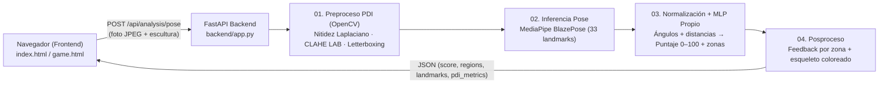

# Plan de Implementación — MIMESIS (Camino A)

## Objetivo General

Construir la versión funcional y defendible de **MIMESIS** para el proyecto final de **Procesamiento Digital de Imágenes (PDI)** bajo el **Camino A**:
1. **Rediseñar la interfaz web** ([index.html](file:///d:/Universidad/Procesamiento%20Digital%20de%20imagenes/ProyectoFinal/Mimesis/index.html), [game.html](file:///d:/Universidad/Procesamiento%20Digital%20de%20imagenes/ProyectoFinal/Mimesis/game.html) y [css/](file:///d:/Universidad/Procesamiento%20Digital%20de%20imagenes/ProyectoFinal/Mimesis/css)) con una estética editorial de museo contemporáneo (eliminando el aspecto genérico de "plantilla IA") y dejar únicamente las **3 esculturas reales** del dataset del equipo: **Sebastián de Belalcázar**, **El Discóbolo** y **William Shakespeare**.
2. **Implementar un backend en Python (`FastAPI`)** que ejecute un pipeline real y medible de **PDI clásico (OpenCV)** + **MediaPipe BlazePose** + **normalización geométrica** + **modelo evaluador MLP propio** y sirva directamente la aplicación web en `localhost:8000`.
3. **Crear el notebook de entrenamiento y evaluación en Google Colab** reutilizando las **480 fotos reales del Parcial 2**, generando las poses de referencia, entrenando el MLP y produciendo las métricas comparativas contra el *baseline* CNN del Parcial 2 para el informe, el póster y la sustentación.

---

## Arquitectura Propuesta

---

## Revisión Requerida por el Usuario

> [!IMPORTANT]
> **Entorno Python local:** Al revisar tu equipo, `py -0` reportó que **no hay una instalación local de Python detectada**. Para ejecutar el backend (`FastAPI + OpenCV + MediaPipe + PyTorch`) en tu computador necesitarás instalar **Python 3.11** (recomendado porque MediaPipe tiene ruedas estables en 3.10–3.11). Mientras tanto, el entrenamiento del MLP se puede hacer en **Google Colab** (como en los parciales) y solo descargar los pesos `.pt` al repositorio.

> [!IMPORTANT]
> **Imágenes de las 3 esculturas:** En el repositorio aún no existe la carpeta `assets/sculptures/`. Necesitaremos 3 fotos reales y limpias de **Sebastián de Belalcázar**, **El Discóbolo** y **William Shakespeare** (de cuerpo completo o donde se aprecie claramente la pose que imitaron en el Parcial 2) para guardarlas en `assets/sculptures/` y extraer sus landmarks de referencia.

---

## Preguntas Abiertas

1. **Dirección estética de la interfaz:** Para quitar el aspecto "muy IA" (fondo azul oscuro `#0b1018` + acento cian neón `#65c7b5` + íconos `◈/◉`), propongo una estética de **galería / museo editorial**:
   - **Opción A (Museo oscuro cálido):** fondo carbón/piedra oscura (`#141311`), tarjetas en pizarra cálida (`#1E1C19`), texto marfil (`#F4EFE6`), acento bronce/terracota (`#C88D55`), tipografía editorial serif (*Cormorant Garamond*) para títulos + sans limpia (*DM Sans*) para controles, e íconos SVG minimalistas.
   - **Opción B (Museo claro / catálogo de arte):** fondo piedra/papel cálido (`#F5F1EA`), tarjetas blancas con bordes sutiles de 1px (`#DCD4C8`), texto tinta (`#1B1917`), acento terracota/bronce (`#9E5A36`).
   ¿Cuál prefieres?
2. **Imágenes de las 3 esculturas:** ¿Ya tienen ustedes las 3 imágenes de referencia de Belalcázar, Discóbolo y Shakespeare (por ejemplo, en Drive o en el PC), o prefieres que dejemos el catálogo listo con rutas locales en `assets/sculptures/` para que las peguen ahí?
3. **Python local:** ¿Quieres que trabajemos primero el **rediseño completo del frontend + estructura del backend + notebook de Colab**, y luego instalamos Python 3.11 para encender el servidor local y probarlo con tu cámara?

---

## Cambios Propuestos

### 1. Frontend — Rediseño Editorial y Catálogo Real (3 Esculturas)

Se elimina el aspecto genérico de "plantilla IA", se separa el JS y CSS embebidos para mantener el proyecto limpio, y se completa el flujo de ranking.

#### [MODIFY] [styles.css](file:///d:/Universidad/Procesamiento%20Digital%20de%20imagenes/ProyectoFinal/Mimesis/css/styles.css)
- Reemplazar la paleta azul oscuro/neón cian por paleta editorial de museo (según la opción elegida) con tokens semánticos (`--bg`, `--surface`, `--ink`, `--accent`, `--ok`, `--warn`, `--low`).
- Cargar fuentes editoriales (`Cormorant Garamond` + `DM Sans` con fallbacks de sistema).

#### [MODIFY] [layout.css](file:///d:/Universidad/Procesamiento%20Digital%20de%20imagenes/ProyectoFinal/Mimesis/css/layout.css)
- Ajustar la galería de 5 columnas a **3 columnas equilibradas** para las 3 esculturas reales.
- Incluir los estilos de layout de `game.html` (actualmente duplicados en un `<style>` de 270 líneas dentro de `game.html`).

#### [MODIFY] [components.css](file:///d:/Universidad/Procesamiento%20Digital%20de%20imagenes/ProyectoFinal/Mimesis/css/components.css)
- Rediseñar tarjetas con estilo de **ficha museográfica** (etiquetas discretas, bordes finos, sin brillos radiales ni símbolos Unicode `◈/◉`, usando SVGs limpios).
- Agregar estilos para el **modal/panel de Ranking por ronda y acumulado**, indicadores de calidad PDI (nitidez/iluminación) y leyenda del mapa de calor por zona.

#### [NEW] `js/sculptures.js`
- Catálogo centralizado con las **3 esculturas reales** (compartido entre `index.html` y `game.html`):
  - `belalcazar`: *Monumento a Sebastián de Belalcázar* (Victorio Macho · 1937) — Emoción: *Determinación*.
  - `discobolo`: *El Discóbolo* (Mirón de Eléuteras · c. 455 a. C.) — Emoción: *Tensión y enfoque*.
  - `shakespeare`: *William Shakespeare* (Estatua clásica / pose dramática) — Emoción: *Contemplación*.
- Cada entrada incluye `id`, `title`, `author`, `emotion`, `description`, `poseTips`, e imagen local `assets/sculptures/<id>.jpg`.

#### [MODIFY] [index.html](file:///d:/Universidad/Procesamiento%20Digital%20de%20imagenes/ProyectoFinal/Mimesis/index.html)
- Corregir rutas relativas (`css/styles.css` en vez de `/css/styles.css`).
- Conectar con `js/sculptures.js` y `js/lobby.js` (mover el script embebido a archivo propio).
- Mostrar solo las 3 esculturas, selección de 2–4 jugadores (permitiendo editar nombres sin `window.prompt`), y botón de inicio de partida.

#### [MODIFY] [game.html](file:///d:/Universidad/Procesamiento%20Digital%20de%20imagenes/ProyectoFinal/Mimesis/game.html)
- Extraer el CSS embebido a `css/` y la lógica a `js/game.js`.
- Mantener la captura con cámara web + cuenta regresiva + opción de **subir foto de prueba** (muy útil para pruebas y sustentación si falla la iluminación o la cámara).
- Colorear los segmentos del esqueleto SVG según la similitud de cada región (**Cabeza, Torso, Brazos, Piernas**: verde ≥ 80, ámbar 55–79, terracota/rojo < 55).
- Mostrar la **ficha de diagnóstico PDI** recibida del backend (nitidez Laplaciano, corrección CLAHE aplicada, confianza promedio de detección).
- Implementar el **Ranking funcional** al finalizar cada ronda y opción de **Repetir intento** o **Pasar turno** (RF-12 y RF-13).

---

### 2. Backend Python — Pipeline PDI + BlazePose + Evaluador MLP

Todo el análisis vive en `backend/` y sirve también los archivos estáticos del frontend en `http://localhost:8000` (evitando errores de CORS y habilitando `getUserMedia` en `localhost`).

#### [NEW] `backend/requirements.txt`
- `fastapi`, `uvicorn[standard]`, `python-multipart`, `opencv-python`, `mediapipe`, `numpy`, `torch` (o `scikit-learn` / `onnxruntime` según prefieran para inferencia ligera).

#### [NEW] `backend/pdi.py`
Módulo dedicado de **Procesamiento Digital de Imágenes**:
- `decode_image(image_bytes)`: decodificación segura a BGR.
- `compute_sharpness(img_bgr)`: cálculo de **varianza del Laplaciano** (`cv2.Laplacian`) para detectar fotos borrosas.
- `apply_adaptive_clahe(img_bgr)`: conversión a espacio de color **LAB**, medición de luminancia media en canal `L` y aplicación de **CLAHE** (`clipLimit=2.0, tileGridSize=(8,8)`) si la iluminación es baja o con contraste pobre.
- `letterbox_resize(img_bgr, target_size=640)`: redimensionamiento preservando relación de aspecto con relleno (*padding*) + devolución de parámetros de escala/offset para mapear los landmarks de vuelta a la imagen original sin distorsión.

#### [NEW] `backend/pose.py`
- Extracción de **33 landmarks** con `mediapipe.solutions.pose` (`static_image_mode=True, model_complexity=2`).
- Validación de encuadre y visibilidad mínima por región (`head`, `torso`, `arms`, `legs`).
- **Normalización geométrica propia:**
  - Traslación al centro de caderas.
  - Escalado por longitud de torso (distancia hombros–caderas).
  - Extracción de vector de características: **ángulos articulares** (codos, hombros, caderas, rodillas, inclinación de torso y cabeza) + coordenadas relativas normalizadas.

#### [NEW] `backend/evaluator.py`
- Carga `backend/data/reference_poses.json` (poses de referencia de Belalcázar, Discóbolo y Shakespeare).
- Calcula similitud por región (`head`, `torso`, `arms`, `legs`) a partir de diferencias angulares/vectoriales ponderadas por visibilidad.
- Evalúa la similitud global `0–100` usando el **modelo MLP entrenado** (`backend/models/pose_mlp.pt`), con respaldo geométrico determinístico si aún no se han copiado los pesos entrenados.
- Genera consejos concretos de corrección (ej. *"Inclina un poco más el torso hacia adelante"*, *"Eleva el brazo derecho"*).

#### [NEW] `backend/app.py`
- Endpoints:
  - `GET /api/health` → estado del servicio y si el modelo MLP está cargado.
  - `POST /api/analysis/pose` → recibe `image`, `player`, `sculpture`, `round`; corre `pdi.py` → `pose.py` → `evaluator.py` y devuelve el JSON esperado por `game.html`.
- Monta los archivos estáticos (`/`, `/css`, `/js`, `/assets`) para abrir todo desde `http://localhost:8000`.

---

### 3. Notebook de Entrenamiento y Evaluación (Google Colab)

#### [NEW] `notebooks/Mimesis_MLP_Entrenamiento.ipynb`
Notebook autocontenido para ejecutar en Colab con el dataset de Drive (`PDI - Parcial2`, 480 fotos):
1. Recorre las carpetas `train / val / test` de `Belalcazar`, `Discobolo` y `Shakespeare` respetando exactamente la partición sin fuga de datos del Parcial 2.
2. **Experimento PDI:** compara la tasa de detección y confianza media de BlazePose **sin preprocesamiento vs. con CLAHE + letterboxing** (evidencia cuantitativa de PDI).
3. Construye las **poses de referencia** (pose prototipo por escultura) y exporta `reference_poses.json`.
4. Genera pares positivos/negativos y perturbaciones controladas para entrenar el **MLP evaluador en PyTorch** (clasificación de pose + puntaje de similitud continuo `0–100`).
5. Reporta métricas finales en `test`: Accuracy, F1, matriz de confusión, MAE de similitud y **tabla comparativa directa contra la CNN del Parcial 2 (83.3 % val vs. Pipeline PDI + BlazePose + MLP)**.
6. Exporta `pose_mlp.pt` y `reference_poses.json` listos para copiar a `backend/`.

---

### 4. Documentación del Repositorio

#### [MODIFY] [README.md](file:///d:/Universidad/Procesamiento%20Digital%20de%20imagenes/ProyectoFinal/Mimesis/README.md)
- Reemplazar el README actual (que describe erróneamente un "Juego de Simulación 3D") por la documentación oficial de MIMESIS con las 8 secciones que exige [Rubrica proyecto final PDI 2026-2.pdf](file:///d:/Universidad/Procesamiento%20Digital%20de%20imagenes/ProyectoFinal/Mimesis/Rubrica%20proyecto%20final%20PDI%202026-2.pdf): Descripción, Arquitectura, Metodología, Implementación, Datos, GUI, Resultados y Conclusiones.

---

## Plan de Verificación

### Pruebas Automatizadas
1. **Pruebas unitarias del módulo PDI y geometría (`backend/tests/test_pipeline.py`):**
   - Verificar que `compute_sharpness` distingue una imagen nítida de una imagen desenfocada con `GaussianBlur`.
   - Verificar que `apply_adaptive_clahe` mejora el contraste de una imagen subexpuesta sin alterar dimensiones.
   - Verificar que `letterbox_resize` preserva relación de aspecto y que la proyección inversa de coordenadas devuelve los mismos puntos `(x, y)` normalizados.
   - Verificar que la normalización geométrica es invariante a traslación y escalado.
2. **Prueba de integración del endpoint (`POST /api/analysis/pose`):**
   - Enviar una foto real de prueba vía `TestClient` de FastAPI y validar el esquema JSON (`score` en `[0, 100]`, 33 `landmarks`, 4 regiones en `regions`, y `pdi_metrics`).

### Verificación Manual
1. Levantar el servidor local (`uvicorn backend.app:app --reload`) y abrir `http://localhost:8000`.
2. Configurar 2–4 jugadores en `index.html`, elegir cada una de las 3 esculturas (*Belalcázar*, *Discóbolo*, *Shakespeare*) y verificar que el rediseño se vea limpio en escritorio y móvil.
3. En `game.html`, probar tanto **captura con cámara web** como **carga de foto de prueba**, confirmar que se dibuja el esqueleto coloreado por zona, que aparecen las métricas PDI y que el **Ranking** se actualiza correctamente entre turnos y rondas.
4. Ejecutar `notebooks/Mimesis_MLP_Entrenamiento.ipynb` en Google Colab con las 480 fotos de Drive, verificar las métricas en `test` y cargar los pesos `pose_mlp.pt` + `reference_poses.json` en `backend/`.
